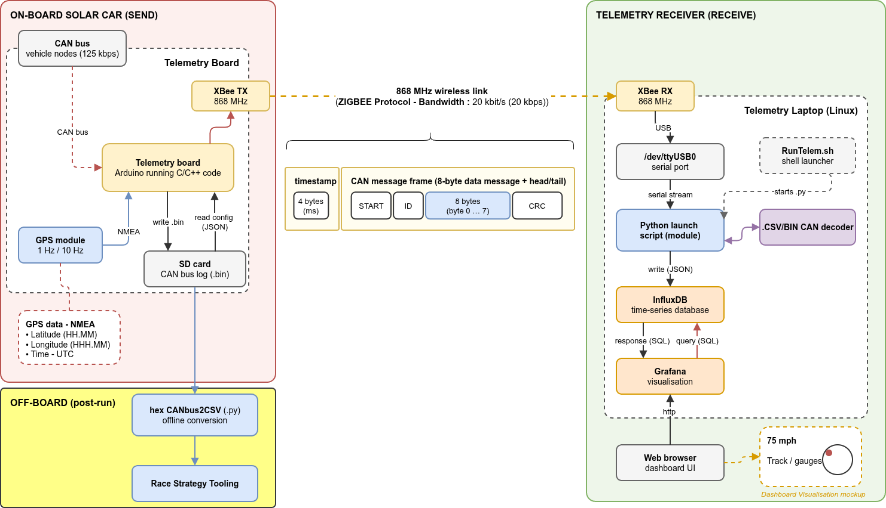

# DUSC Telemetry @ Peri (2026+)

_The telemetry system for the Peri vehicle (2026 onwards): the BWSC 2023 on-vehicle firmware with the 2024 Python receiver, which decodes CAN messages using DBC files. Tested with Peri, Nov 2026._

## System overview



```
 Vehicle CAN bus (125 kbps)
   │  BMS (Orion), motor controller (Tritium WaveSculptor), MPPTs, driver controls ...
   ▼
 Arduino Mega 2560 telemetry board  ──►  SD card (raw .BIN log of every frame)
   │  MCP2515 CAN controller, Adafruit GPS
   │  XBee radio on Serial2 @ 115200 baud
   ▼
 XBee (USB) on the telemetry laptop  →  /dev/ttyUSB0
   ▼
 python3 -m Receiver.LiveTelemetry  (CRC check, decode with dbc/*.dbc)
   │                                 ──►  optional Excel / CSV files
   ▼
 InfluxDB 1.x (database "DUSCiESC")  ◄──►  Receiver/live_calculations (optional)
   ▼
 Grafana dashboard (not stored in this repository)
```

* [SETUP.md](SETUP.md): **building a telemetry laptop from scratch**: Ubuntu (on a laptop, or in a VirtualBox VM with the XBee USB passed through), InfluxDB 1.x and Grafana
* [Telemetry/README.md](Telemetry/README.md): on-vehicle firmware (building, flashing, SD card `config.txt`, radio frame format)
* [Receiver/README.md](Receiver/README.md): laptop receiver (configuration, DBC decoding, InfluxDB schema, offline tools, testing without hardware)
* [dbc/SIGNALS.md](dbc/SIGNALS.md): **what every CAN message and signal means**, its unit, and what to query in Grafana (generated from the DBC files; [dbc/README.md](dbc/README.md) introduces CAN and DBC files for non-specialists)
* [Receiver/live_calculations/README.md](Receiver/live_calculations/README.md): extra values calculated from the live data (route distance, incline, power)
* [Client/README.md](Client/README.md): uploading a SolarSim race strategy to InfluxDB

## Branches

| Branch | Contents |
|---|---|
| `PERI-DEVELOPMENT-TPB-1126` | **This branch.** The code used with Peri (2026+): BWSC 2023 firmware plus the DBC-based Python receiver, with tests. |
| [`ESC-CODE`](https://github.com/DUEM/Telemetry2021/tree/ESC-CODE) | The cut-down code used at ESC 2024 and ESC 2026. Same firmware, simpler receiver (see [below](#how-this-differs-from-the-esc-code-branch)). |
| [`nick-22Library`](https://github.com/DUEM/Telemetry2021/tree/nick-22Library) | Default branch. The full BWSC 2023-era code base, including newer firmware (CANApi v1.0-beta.3) not yet merged here. |

## How this differs from the ESC-CODE branch

Both branches run the **same firmware** on the vehicle (same [Telemetry/](Telemetry/) code and CANApi submodule commit), so they receive exactly the same radio frames. The receivers are different, and **they write different InfluxDB schemas, so Grafana dashboards are not interchangeable between them.**

| | This branch | [`ESC-CODE`](https://github.com/DUEM/Telemetry2021/tree/ESC-CODE) |
|---|---|---|
| Receiver | Python package, run as `python3 -m Receiver.LiveTelemetry` | Single script, [`Live-Telem-05-09-2024-WIP.py`](https://github.com/DUEM/Telemetry2021/blob/ESC-CODE/Receiver/Live-Telem-05-09-2024-WIP.py), started by `RunTelemetry.sh` |
| CAN definitions | Standard `.dbc` files in [dbc/](dbc/), decoded with cantools | [`CAN-decode-sheet.csv`](https://github.com/DUEM/Telemetry2021/blob/ESC-CODE/Receiver/CAN-decode-sheet.csv) |
| CRC check | **Yes**: corrupted frames are not written to InfluxDB | No |
| Timestamps | Vehicle GPS time plus the board's `millis()` | Laptop receive time |
| InfluxDB measurements | One per CAN message, `<Source>/<Item>` (e.g. `Orion/PackParameters`), one field per signal ([schema](Receiver/README.md#influxdb-schema)) | One per signal (e.g. `Pack SOC`), field `Float_value` ([schema](https://github.com/DUEM/Telemetry2021/blob/ESC-CODE/Receiver/README.md#influxdb-schema)) |
| GPS position | Stored as sent (NMEA `ddmm.mmmm` plus N/S, E/W); converted by `live_calculations` | Converted to decimal degrees in a `location` measurement |
| Unknown CAN IDs | Stored as `ERROR/ID UNRECOGNISED` | Flagged with sentinel row `99` |
| Settings | [Receiver/receiver_config.py](Receiver/receiver_config.py) and the top of `LiveTelemetry.py` | Prompted for port and file names on each run; InfluxDB settings hardwired in the script |
| Live output files | Optional Excel and/or CSV (appended to) | Raw `.BIN` and decoded `.csv` every session (overwritten) |
| Offline tools | [`tools/hex2csv.py`, `tools/hex2influx.py`](Receiver/README.md#offline-tools-sd-card-logs) for SD card logs | None |
| Extra calculations | [live_calculations](Receiver/live_calculations/README.md), [SolarSim upload](Client/README.md) | None |
| Tests | pytest suite in [Tests/](Tests/), run by GitHub Actions | None |

For the ESC-CODE version of the race-day steps and limitations, see its [README](https://github.com/DUEM/Telemetry2021/blob/ESC-CODE/README.md).

## First-time setup (telemetry laptop)

_This assumes Ubuntu, InfluxDB 1.x and Grafana are already installed and set up. If they are not, or you are new to Linux, follow [SETUP.md](SETUP.md) instead, which covers everything from a fresh Ubuntu install (including in a VirtualBox VM) to a working test. The Grafana dashboard is not stored in this repository._

```shell
git clone -b PERI-DEVELOPMENT-TPB-1126 --recurse-submodules git@github.com:DUEM/Telemetry2021.git
cd Telemetry2021
python3 -m venv ~/virtualenvs/telemetry
source ~/virtualenvs/telemetry/bin/activate
pip install -r Receiver/requirements.txt
sudo usermod -aG dialout $USER     # serial port access; log out and in again afterwards
```

Create the database the receiver writes to (set in [Receiver/receiver_config.py](Receiver/receiver_config.py)):

```shell
influx
> CREATE DATABASE "DUSCiESC"
> exit
```

The [live calculations](Receiver/live_calculations/README.md) and the [SolarSim upload](Client/README.md) have their own requirements files. Install those only if you need them.

## How to run telemetry (race day)

1. Plug in the XBee and check it shows up as a serial port:
   ```shell
   ls /dev/ttyUSB*
   ```
   You would normally expect `/dev/ttyUSB0`. If it is different, change `SERIALPORT` at the top of [Receiver/LiveTelemetry.py](Receiver/LiveTelemetry.py).

2. Make sure InfluxDB is running:
   ```shell
   systemctl status influxd.service
   curl -sl -I http://localhost:8086/ping
   ```

3. Start the receiver from the top of the repository:
   ```shell
   cd Telemetry2021
   source ~/virtualenvs/telemetry/bin/activate
   python3 -m Receiver.LiveTelemetry
   ```
   Every decoded message is printed to the terminal, with `CRC OK` or `CRC FAIL`.

4. Check that data is reaching InfluxDB:
   ```shell
   influx -database DUSCiESC -execute 'SHOW MEASUREMENTS'
   ```

5. Open the Grafana dashboard in a browser (Grafana's default address is <http://localhost:3000>).

6. Press **Ctrl-C** to stop the receiver. Any Excel or CSV output files are closed and saved.

## Maintenance

Export a measurement from InfluxDB to CSV:

```shell
influx -database DUSCiESC -execute 'SHOW MEASUREMENTS'
influx -database DUSCiESC -execute 'SELECT * FROM "Orion/PackParameters"' -format csv > /path/to/export.csv
```

Measurement names contain `/`, so they must be double-quoted (see the InfluxDB schema in [Receiver/README.md](Receiver/README.md#influxdb-schema)).

To decode the raw `.BIN` log from the board's SD card after a session, see the offline tools in [Receiver/README.md](Receiver/README.md#offline-tools-sd-card-logs).

Run the tests:

```shell
pip install -r Tests/requirements-test.txt
pytest
```

## Updating the code on the laptop

You need internet access for this.

```shell
cd Telemetry2021
git switch PERI-DEVELOPMENT-TPB-1126
git pull origin PERI-DEVELOPMENT-TPB-1126
git submodule update --init
git status
```

The output should show:

```
On branch PERI-DEVELOPMENT-TPB-1126
Your branch is up to date with 'origin/PERI-DEVELOPMENT-TPB-1126'
```

Then switch back to the telemetry LAN.

## Updating the telemetry board

Update the code as above (the `git submodule update --init` step is required, because the firmware depends on the `CANApi` submodule). Then follow the build and upload steps in [Telemetry/README.md](Telemetry/README.md).

## Files in this repository

```
├── README.md
├── SETUP.md                       (building a telemetry laptop: Ubuntu / VirtualBox, InfluxDB, Grafana)
├── dbc/                           (CAN database files used to decode messages, by the receiver and the tests)
│   ├── README.md                  (CAN and DBC files explained, how to change them)
│   ├── SIGNALS.md                 (generated reference: every message and signal; do not edit)
│   ├── wavesculptor_22.dbc        (Tritium motor controller, driver controls)
│   ├── Orion.dbc                  (BMS)
│   ├── MPPT.dbc                   (MPPTs and the board's MPPT poll requests)
│   └── Telemetry.dbc              (the board's own GPS and status messages)
├── tools                          (standalone scripts: python3 tools/<script>.py)
│   ├── hex2csv.py                 (offline: SD card .BIN → CSV)
│   ├── hex2influx.py              (offline: SD card .BIN → InfluxDB)
│   ├── batch_Read_Hex.py          (offline: hex2influx.py for a folder of .BIN files)
│   └── dbc_to_markdown.py         (generates dbc/SIGNALS.md from the DBC files)
├── Receiver                       (Python receiver software, see Receiver/README.md)
│   ├── LiveTelemetry.py           (live receiver: serial → decode → storage plugins)
│   ├── receiver_config.py         (InfluxDB credentials, output files, DBC file list)
│   ├── frame_reader.py            (splits a capture into frames on 0x7E)
│   ├── telemetry_parser3.py       (CRC check, timestamps, decoding)
│   ├── can_dbc_decoder.py         (DBC lookup with cantools)
│   ├── telemetry_storer.py        (passes decoded messages to the storage plugins)
│   ├── storer_extension.py        (InfluxDB, Excel and CSV storage plugins)
│   ├── requirements.txt
│   └── live_calculations          (route distance, incline and power, see its README.md)
├── Client                         (SolarSim strategy upload to InfluxDB, see Client/README.md)
├── Tests                          (pytest suite)
│   └── data                       (sample captures NRT.BIN, MPPT.BIN and their expected decoded .csv)
├── Telemetry                      (on-vehicle Arduino firmware, see Telemetry/README.md;
│   │                                same as the ESC-CODE branch)
│   ├── Telemetry.ino              (setup / main loop)
│   ├── SendMessage.cpp/.hpp       (radio framing, CRC, SD logging)
│   ├── SensorInputs.cpp/.hpp      (GPS)
│   ├── SD.cpp/.hpp                (SD card and config.txt loading)
│   ├── StatusMsg.cpp/.hpp         (system status message)
│   ├── SerialDebugMacros.hpp
│   ├── UseMsgList.hpp             (which CAN messages the board handles)
│   ├── config.txt                 (copy to the SD card root)
│   └── src/CANApi                 (git submodule: DUEM/CANApi)
├── .github/workflows              (GitHub Actions: runs pytest on Python 3.9 to 3.11)
├── pytest.ini, .coveragerc        (test and coverage settings)
└── pylintrc
```

## Known limitations

**Radio link and framing**
* Frames are terminated by `0x7E`, but `0x7E` bytes inside the frame are not escaped. If any timestamp, data or CRC byte equals `0x7E`, the frame is split. The pieces then almost always fail the CRC check, so the message is lost but does not reach InfluxDB corrupted.
* The live receiver does not keep a raw copy of the received bytes. The `.BIN` log on the board's SD card is the only raw record of a session.

**Decoding**
* Only CAN IDs in the `dbc/` files are decoded. Others are written to InfluxDB as `ERROR/ID UNRECOGNISED`. Check the DBC files cover any new hardware on the vehicle.
* The Orion BMS signals, and the MPPT `VoltageOut` and `AmbientTemperature`, are still stored as raw values: their scaling has to come from the Orion BMS profile loaded on Peri and the MPPT datasheet. These and the other gaps are marked `TODO: add ...` in the DBC files and listed at the end of [dbc/SIGNALS.md](dbc/SIGNALS.md#still-to-be-documented).
* GPS latitude and longitude are stored as sent (NMEA `ddmm.mmmm` with a separate N/S, E/W character), not as decimal degrees, so they cannot be used directly by a Grafana map panel. [road_lookup.py](Receiver/live_calculations/road_lookup.py) does the conversion.
* Latitude and longitude are sent as separate CAN messages, which can lead to mismatched positions.

**Timestamps**
* Until the first valid GPS time message arrives, timestamps are based on the laptop's clock when the receiver started plus the board's uptime, so they are only approximate.

**Usability**
* The serial port is hardwired in [Receiver/LiveTelemetry.py](Receiver/LiveTelemetry.py).
* InfluxDB details (host, port, user `admin`, password) are stored in plain text, and the database name differs between scripts: `DUSCiESC` (receiver), `Test22DB` (`tools/hex2influx.py`, `live_calculations/config.py`) and `test` (`Client/upload_solarsim.py`).
* The Excel output is saved every 10 s (`xlsxSaveInterval`) and when the receiver stops. If the receiver is killed without Ctrl-C, up to that many seconds of rows are missing from the Excel file (the SD card log still has them).
* The Grafana dashboard is not stored in this repository.

**Firmware**
* The firmware has not been updated to the newer CANApi v1.0-beta.3 firmware on the `nick-22Library` branch.

## History

* BWSC 2023: on-vehicle firmware and the original spreadsheet-based receiver (see branch `nick-22Library`)
* ESC 2024: separate, simpler receiver script written by Ethan Glen (EG) (see branch `ESC-CODE`)
* 2024: receiver rewritten as a Python package with DBC decoding, storage plugins and tests, by Owen Foo (OF)
* Peri (2026+): updated and tested with Peri (Nov 2026) by Toby B (TPB), Ben G (BG) and Ben J (BJ)
